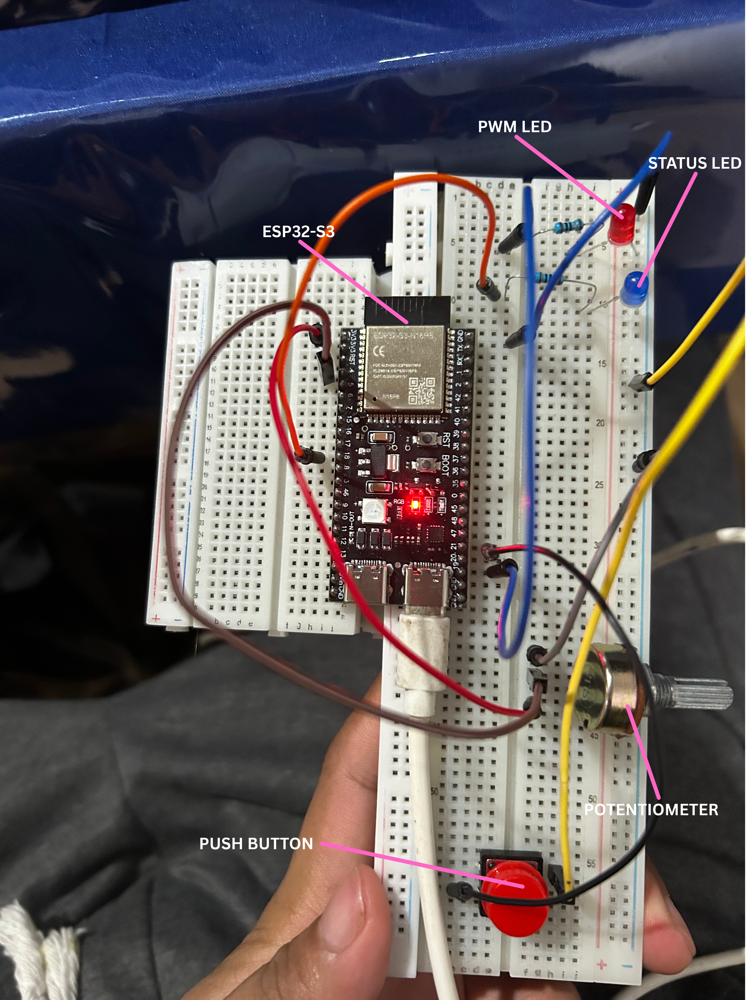

# BCA188 – Laboratory Activity 5: Structured Workstation Light

## Hardware & Wiring (ESP32-S3-DevKitC-1)
- **Digital Input (`GPIO21`):** Normally open pushbutton between `GPIO21` and `GND` (`INPUT_PULLUP` enabled, active-low; adapted from `GPIO23` for ESP32-S3-DevKitC-1)[cite: 1].
- **Analog Input (`GPIO4`):** 10 kΩ potentiometer outer pins to `3V3` and `GND`, center wiper to `GPIO4` (`ADC1_CH3`)[cite: 1].
- **Digital Output (`GPIO18`):** `GPIO18` $\rightarrow$ `330 Ω` resistor $\rightarrow$ Status LED anode (`+`), cathode (`−`) to `GND`.
- **PWM Output (`GPIO19`):** `GPIO19` $\rightarrow$ `330 Ω` resistor $\rightarrow$ Brightness LED anode (`+`), cathode (`−`) to `GND`.

```text
3V3 (ESP32-S3)  ── Potentiometer Outer Pin 1
GPIO4 (ADC1_3)  ── Potentiometer Middle Pin (Wiper)
GND (ESP32-S3)  ── Potentiometer Outer Pin 2

GPIO21          ── [Pushbutton] ── GND
GPIO18          ── [330 Ω Resistor] ── Status LED (+) | (−) ── GND
GPIO19          ── [330 Ω Resistor] ── Brightness LED (+) | (−) ── GND
```

### Labeled Circuit Wiring


## Firmware Organization & Variable Roles
- **Constants (`const uint8_t`):** Store immutable GPIO pin numbers (`BUTTON_PIN`, `POT_PIN`, `STATUS_LED_PIN`, `PWM_LED_PIN`).
- **Boolean State (`bool`):** `buttonPressed` captures whether the active-low switch is held; `pwmReady` confirms successful `ledcAttach()` initialization before driving PWM.
- **Numeric Readings (`int`):** `rawInput` stores the 12-bit ADC sample (`0–4095`), `requestedDuty` stores the scaled `0–255` duty computed by `scaleToDuty(int raw)`, and `appliedDuty` stores the final gated duty (`requestedDuty` when held, `0` when released).

## Expected vs. Observed Behavior

| Test Condition / Knob Position | Button State | Expected Status LED (`GPIO18`) | Expected Brightness LED (`GPIO19`) | Observed Behavior |
| :--- | :---: | :---: | :---: | :--- |
| **Reset with button released** | Released | OFF | OFF (`duty = 0`) | Both LEDs remain OFF |
| **Rotate knob while released** | Released | OFF | OFF (`duty = 0`) | Knob rotation has no effect on output |
| **Low knob position (~0%)** | Held | ON | OFF (`duty ≈ 0`) | Status LED ON; brightness LED off |
| **Middle knob position (~50%)** | Held | ON | Medium (`duty ≈ 127`) | Status LED ON; brightness LED ~50% |
| **High knob position (~100%)** | Held | ON | Maximum (`duty = 255`) | Status LED ON; brightness LED full brightness |
| **Release button from High** | Released | OFF | OFF (`duty = 0`) | Both LEDs turn OFF immediately |
